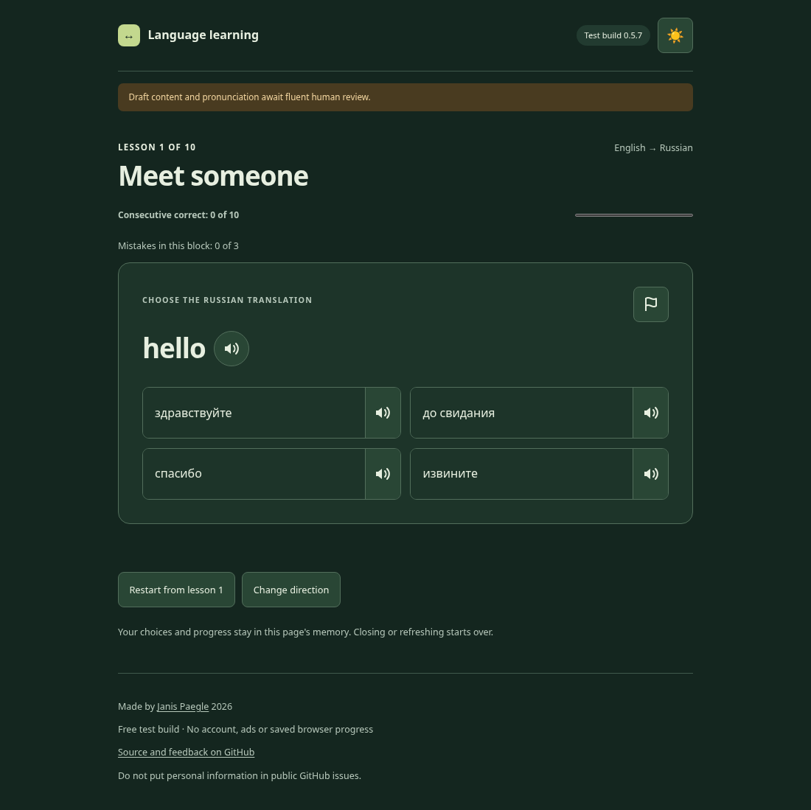

# Language Learning App

**[Try the app](https://janisp123.github.io/language-learning-app/learn/)** · [Project website](https://janisp123.github.io/language-learning-app/)

Short lessons for practical Latvian, Russian and English communication, plus English → Japanese for my own learning. Free to try in a browser, with pronunciation and no account or installation.

I'm Janis. I wanted a simple way to practise useful everyday words and phrases, and a chance to see how far an idea could go with AI assistance. I use ChatGPT and Codex to help turn requirements into code, tests and working applications. This is a hobby project: I enjoy experimenting, checking the results and learning as I build.



## What works today

- 510 draft words and short phrases in 51 ten-question lessons, initially designed around ages 10–17.
- Exactly seven directions: all six between Latvian, Russian and English, plus **English → Japanese only**. Japanese answers use Japanese script; this direction keeps the English interface.
- Bundled pronunciation for every item in all four languages. The current prompt attempts playback automatically; its speaker replays it if autoplay is blocked. Each answer has its own speaker, which plays without submitting an answer.
- A responsive browser interface with light/dark mode. The project website has EN/RU/LV reading controls; the learning interface follows the source language.
- Offline practice after downloading the self-contained HTML. No accounts, ads or tracking in the app.

**Zero saved learner progress:** answers, counters and preferences stay in current page memory. Every reload or fresh session starts at lesson 1. There are no progress files, saved records or daily streaks. Website dark mode carries into learning for that visit; a clean reload starts light.

**Still a review build:** fluent human translation/pronunciation review, physical-device testing and a full accessibility review remain pending. Android and Google Play delivery are not implemented. Working browser features do not mean the course has been independently reviewed.

## How practice works

Choose a direction and start. Select answer text to submit it, or tap any speaker just to listen. Choices reshuffle each time a prompt appears. Feedback is immediate; the next prompt appears after 500 ms.

Ten consecutive correct answers complete a lesson. A wrong answer steps back one prompt and resets the consecutive run. The third mistake within the same lesson restarts at lesson 1, even if correct answers came between mistakes. Completing a lesson or restarting clears that lesson's mistake counter.

## Use it offline

[Download the portable HTML](https://janisp123.github.io/language-learning-app/language-learning-test.html), save it with the `.html` extension and open the saved file in a browser. No server or network is needed after download; course and audio are bundled.

The same generated file is available in [the repository download](downloads/language-learning-test.html). Use GitHub's **Download raw file** control: its source viewer does not run the app. Local HTML handling varies by phone; physical-device verification remains pending.

## Source and checks

The app uses plain JavaScript, HTML and CSS, JSON course modules, Python packaging, Node/Python tests and GitHub Actions. There is no framework or runtime dependency installation. ChatGPT and Codex assist with implementation and documentation; the source and verification records remain inspectable.

```sh
npm test
python -m unittest discover -s tests -p 'test_*.py' -v
python tools/build_browser.py
```

Requires Node 24+ and Python 3.12+. The generated file is `dist/language-learning-test.html`; the committed download is built from the same canonical sources and checked for parity in CI.

| Area | Source |
|---|---|
| Course | `content/`: catalog, permanent concepts, ten-question blocks and per-language modules |
| Learning rules | `core/`: platform-independent learning behavior |
| Browser interface | `web/`: template, styles, audio and event handling |
| Packaging and checks | `tools/` and `tests/` |
| Website | `docs/discovery-preview/index.html`, staged by the existing Pages workflow |

## Contributing and project records

Start with [contribution guidance](CONTRIBUTING.md) and [AGENTS.md](AGENTS.md). Helpful feedback includes unclear wording, audio issues and reproducible browser problems; use synthetic examples and never include personal learner information.

- [Testing guide and verification limits](docs/BROWSER_TEST_BUILD.md)
- [Common words and phrases reference library](library/README.md) · [Common-usage audit and proposed corrections](research/common-usage/README.md) (reference/review only)
- [Content module guide](docs/CONTENT_MODULES.md) · [Current curriculum](docs/VOCABULARY_500.md) · [Audio boundaries](docs/AUDIO_MODULES.md)
- [Architecture](docs/ARCHITECTURE.md) · [Release checklist](docs/RELEASE_CHECKLIST.md) · [Publication instructions](docs/discovery-preview/LAUNCH.md)
- [Active tasks](docs/TD_LIST.md) · [Current checkpoint](docs/WORK_CHECKPOINT.md) · [Change history](docs/CHANGELOG.md)

New content must preserve stable concept/question/correct-answer IDs and the original recordings and translations. Directions use an explicit allowlist; adding a language does not authorize every possible pairing. The earlier 100-item draft remains in `archive/course-0.3/`. Android proposal PR #3 is historical and needs reconciliation with the zero-saves rule before use.

No final brand name or source-code/content license has been selected. Public visibility does not grant a reuse license.

More of my experiments: [GitHub profile](https://github.com/janisp123) · [Mental-health questionnaire](https://github.com/janisp123/mental-health-questionnaire), a separate appointment-preparation project with its own safety and privacy requirements.
